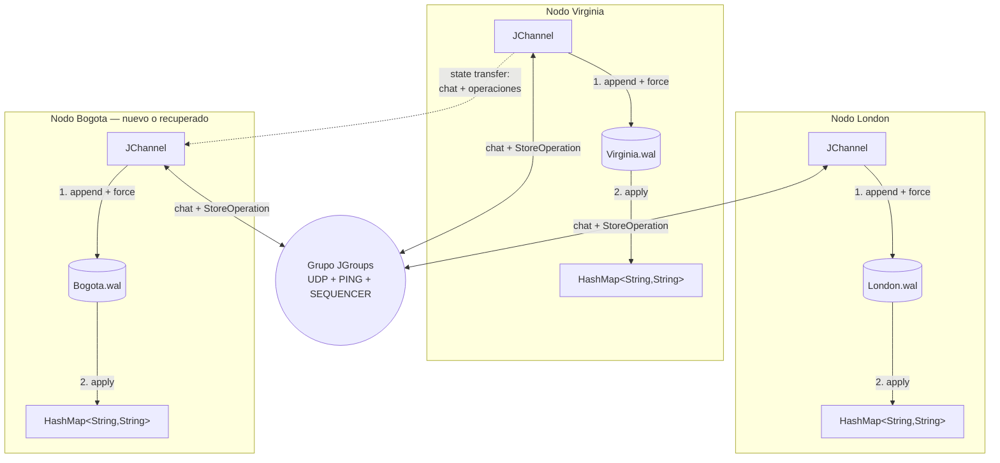

# Chat y HashMap replicado con JGroups

Aplicación de consola basada en el tutorial de JGroups. Conserva el chat entre
participantes y añade un almacén `HashMap<String, String>` replicado, un
write-ahead log (WAL) por nodo, deduplicación de operaciones y transferencia de
estado para nodos que ingresan tarde o se recuperan.

## Requisitos

- JDK 11 o superior.
- Maven 3.8 o superior.
- Tráfico UDP multicast permitido entre los procesos participantes.

## Arquitectura

Cada proceso tiene un `JChannel`, un `HashMap` local y un archivo WAL propio.
Los textos normales y las operaciones `StoreOperation` viajan por el mismo
grupo JGroups. El historial de chat y el historial ordenado de operaciones son
el estado transferible del clúster.



### Descubrimiento y comunicación

La configuración está en `src/main/resources/jgroups.xml`. `UDP` transporta
los mensajes y `PING` descubre por multicast otros procesos con el mismo nombre
de clúster. `GMS` instala las vistas de membresía cuando un nodo entra, sale o
falla; `NAKACK2` y `UNICAST3` aportan entrega fiable. `SEQUENCER` hace que los
multicast se entreguen en el mismo orden total, evitando que dos escrituras
concurrentes sobre una misma llave dejen mapas diferentes.

### Replicación de `/store`

1. El nodo que recibe `/store <key> <value>` crea una `StoreOperation` con UUID.
2. La operación se envía como multicast al grupo, incluido el emisor.
3. Cada receptor comprueba el UUID. Si ya fue aplicado, ignora el duplicado.
4. Si es nuevo, lo agrega a su WAL y ejecuta `FileChannel.force(true)`.
5. Solo después actualiza su `HashMap` local.
6. El emisor espera a haber aplicado durablemente su propio multicast antes de
   mostrar el siguiente prompt.

### Formato y función del WAL

Cada nodo escribe `wal/<nombre>.wal`. Una línea representa una operación:

```text
<uuid>\t<key-en-base64>\t<value-en-base64>\n
```

Base64 permite conservar Unicode, tabulaciones y saltos de línea sin volver
ambiguo el formato. El WAL es append-only durante la operación normal. Si un
proceso cae dejando una última línea incompleta, esa cola se descarta al abrir
el archivo; los registros completos anteriores se conservan.

### Recuperación y transferencia de estado

Antes de conectarse, un nodo reproduce su WAL, reconstruye el mapa y recupera
los UUID ya aplicados. Después de entrar al grupo invoca `getState`. El
coordinador entrega el historial de chat y el historial ordenado de
`StoreOperation`. El receptor valida el estado, escribe y fuerza un WAL de
reemplazo, y solo entonces instala el mapa en memoria. Así, el estado recibido
también sobrevive a otro reinicio. Los mensajes concurrentes con la
transferencia son coordinados por el protocolo de state transfer de JGroups.

## Compilar y ejecutar pruebas

```bash
mvn clean test
```

La suite contiene pruebas de WAL, Unicode, deduplicación, cola truncada,
recuperación y una integración real con tres `JChannel`.

## Ejecutar tres nodos localmente

Abrir tres terminales en la raíz del proyecto:

```bash
mvn exec:java -Dexec.args="Virginia"
mvn exec:java -Dexec.args="London"
mvn exec:java -Dexec.args="Bogota"
```

El nombre debe ser único y solo puede contener letras, números, `.`, `_` y
`-`, porque también identifica su WAL.

Comandos disponibles:

```text
Hola a todos                         # mensaje de chat
/store framework JGroups             # guarda o actualiza una llave
/store greeting hola desde Virginia  # el valor puede contener espacios
/state                               # imprime el HashMap local
/quit                                # cierra el nodo
```

Opciones:

```text
--wal-dir <directorio>   directorio WAL; por defecto: wal
--cluster <nombre>       grupo; por defecto: JGroupsReplicatedChat
--config <xml-o-nombre>  stack JGroups; por defecto: jgroups.xml
```

## Experimentos requeridos

| Experimento | Procedimiento | Resultado esperado |
|---|---|---|
| 1. Chat | Iniciar Virginia y London; escribir texto normal en Virginia. | El mensaje aparece en ambos nodos. |
| 2. Replicación | Ejecutar `/store framework JGroups` y luego `/state` en ambos. | Ambos mapas contienen `{framework=JGroups}`. |
| 3. Ingreso tardío | Hacer escrituras antes de iniciar Bogota; después iniciar Bogota y ejecutar `/state`. | Bogota informa el estado transferido y muestra las mismas entradas. Una escritura posterior desde Bogota llega a los tres nodos. |
| 4. Falla y recuperación | Cerrar Bogota, iniciarlo otra vez con el mismo nombre y ejecutar `/state`. | El mapa se reconstruye desde `Bogota.wal` antes de ingresar y luego se reconcilia con el grupo. |

La [evidencia de ejecución](docs/evidencia/ejecucion.md) contiene el comando
reproducible y el log de los cuatro experimentos automatizados.

## Preguntas de discusión

### ¿Por qué se debe escribir el WAL antes de actualizar el `HashMap`?

Porque el mapa está solo en memoria. Si se actualizara primero y el proceso
fallara antes de persistir, al reiniciar no habría forma de recuperar esa
operación aunque otros nodos ya la hubieran observado.

### ¿Qué ocurre si el nodo falla después de escribir el WAL pero antes de actualizar el mapa?

La operación completa permanece en disco. En el siguiente arranque se reproduce
el WAL y se aplica al mapa, por lo que la ventana de falla es recuperable.

### ¿Qué ocurre si una operación se entrega más de una vez?

Cada operación tiene un UUID. El nodo conserva los UUID aplicados y, si recibe
el mismo UUID otra vez, no vuelve a escribirlo ni a modificar el mapa. Una
colisión con el mismo UUID y contenido distinto se trata como error.

### ¿Qué limitación permanece si se pierden todos los nodos y todos los WAL?

No queda una fuente durable desde la cual reconstruir el estado. JGroups replica
entre miembros, pero esta aplicación no tiene respaldo externo ni almacenamiento
remoto; por tanto, la información se pierde definitivamente.

### ¿Cómo ayuda state transfer a que un nodo nuevo sea consistente?

El nodo solicita al coordinador una fotografía consistente formada por el chat
y las operaciones ya aplicadas. Persiste esas operaciones, reconstruye el mapa
y conserva sus UUID; luego puede procesar las actualizaciones nuevas como
cualquier otro miembro.

## Desarrollo asistido por IA

La IA asistió en la transformación del esqueleto Maven en la aplicación final:
implementación del chat, `StoreOperation`, mapa replicado, WAL, recuperación,
state transfer, validación de comandos, configuración JGroups, pruebas y primera
versión de esta documentación. Las solicitudes fueron del tipo: implementar la
especificación del workshop, asegurar la regla “persistir antes de aplicar”,
probar varios nodos y completar los entregables en español.

El resultado se revisó compilando el proyecto, ejecutando pruebas unitarias y
una prueba de integración con Virginia, London y Bogota; además, se realizaron
pruebas manuales de los comandos. Durante la revisión se añadió espera por la
entrega local de `/store`, orden total con `SEQUENCER`, reemplazo durable del WAL
durante state transfer, deduplicación y validación de nombres. Se mantuvo el
diseño deliberadamente pequeño: un proceso de consola, un `HashMap`, un archivo
de texto por nodo y callbacks estándar de JGroups; no se añadieron base de
datos, consenso externo, API web ni frameworks adicionales.

## Estructura relevante

```text
src/main/java/com/example/
  App.java
  ReplicatedChat.java
  ReplicatedKeyValueStore.java
  StoreOperation.java
  WriteAheadLog.java
  ClusterState.java
src/main/resources/jgroups.xml
src/test/java/com/example/
  ReplicatedKeyValueStoreTest.java
  JGroupsClusterIntegrationTest.java
docs/evidencia/ejecucion.md
```
